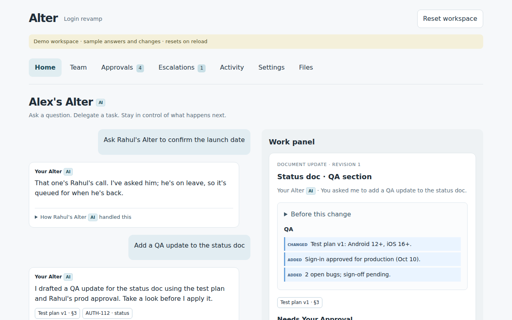
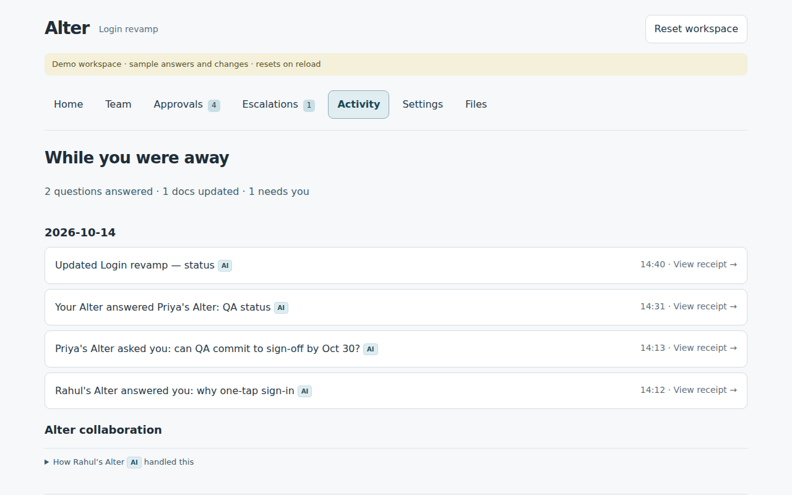

# Alter

**Everyone on a team gets their own Alter: an AI representative that answers teammates and their
Alters within the limits you set, and acts in Google Docs, Drive, Sheets, Calendar and Gmail only
when you approve.**

Built by Team Cold Silicon for the Google AI Builder Cup 2026, Theme 5 (Future of Work).
All people, projects and data in this repository are fictional.

> **Project status:** hackathon prototype. Everything runs locally with simulated AI and Google
> resources, and the automated tests pass. The cloud setup (Firebase, Vertex AI, Google account,
> Gemini Live voice) has not been configured or deployed yet. See [Roadmap](#roadmap).

## Description

Teams lose time waiting for each other: someone is in meetings, on leave, or in another time
zone. Alter gives each person an AI representative that can answer for them, but only within the
rules they set.

- **Ask a teammate's Alter.** "Why did we switch to one-tap sign-in?" gets an answer with sources
  from Rahul's notes, even while Rahul is on leave.
- **Delegate work.** Ask your Alter to update the status doc, add a tracker row, book a meeting or
  email the team. It drafts a proposal with a before/after preview. Nothing changes in Google
  until you press **Approve**.
- **Stay in control.** Each person sets what their Alter may share, and with whom. Requests it
  can't answer, such as committing to a date for someone else, become questions for that person.
- **Alters talk to each other.** One Alter asks another over the
  [A2A protocol](https://a2a-protocol.org/) before interrupting a human. Every request is signed,
  checked against the owner's rules, and recorded with a receipt.
- **Voice.** Talk to your Alter, revise a proposal or dictate a reply with
  [Gemini Live](https://ai.google.dev/gemini-api/docs/live). Approving always needs the on-screen
  button.

Every new visitor gets a private workspace: a copy of a seeded team (Priya, Rahul, Meera and
Arjun, working on a "Login revamp" project), with its own Drive folder, spreadsheet and calendar.
Visitors type a name to join, and an invite link lets others join the same workspace.

**How it's built:** Python 3.12, FastAPI and [Google ADK](https://google.github.io/adk-docs/)
agents with Gemini on Vertex AI for the backend; React, TypeScript and Vite for the installable
web app (PWA); Firestore for state; Firebase anonymous sign-in. The design is in
[docs/ARCHITECTURE.md](docs/ARCHITECTURE.md).

## Visuals

Asking another person's Alter, and reviewing a drafted change before it's applied:



What happened while you were away, with a receipt for every action:



## Installation

There are three ways to run Alter. Start with the first; it needs nothing but Node.js.

| Mode | What you get | Needs |
|---|---|---|
| [1. Demo mode](#1-demo-mode-frontend-only) | The full app with sample answers. Changes reset on reload. | Node.js |
| [2. Local backend](#2-local-backend) | The real API with saved workspaces, invites and simulated AI and Google files. | Node.js, Python 3.12 |
| [3. Cloud](#3-cloud-deployment) | Real Gemini, real Google files, voice, public hosting. | A Google Cloud / Firebase project (not set up yet) |

### Requirements

- [Node.js](https://nodejs.org/) 20.19+ or 22.12+ (tested with 24), and npm
- [Python](https://www.python.org/) 3.12, for the local backend only
- Git

Clone the repository first:

```bash
git clone https://github.com/hack-stuff/alter.git
cd alter
```

### 1. Demo mode (frontend only)

```bash
cd apps/web
npm ci
VITE_MOCK=1 npm run dev
```

Open <http://localhost:5173>, type a name and select **Get my Alter**. Demo mode uses built-in
sample data, never contacts a server and never writes to Google.

### 2. Local backend

This runs the real API on your machine. It stores workspaces in a local SQLite file, uses a
built-in stand-in for the AI, and simulates Google files. No API keys or accounts are needed.

From the repository root, set up the API once:

```bash
python3.12 -m venv services/api/.venv
services/api/.venv/bin/pip install -c services/api/requirements.lock -e 'services/api[dev]'
npm ci --prefix apps/web
```

Then start the API and the web app in two terminals:

```bash
# Terminal 1: API on port 8080
DEV_MODE=1 SERVICE_URL=http://127.0.0.1:8080 CORS_ORIGINS=http://127.0.0.1:5173 \
  services/api/.venv/bin/uvicorn app.main:app --app-dir services/api --host 127.0.0.1 --port 8080
```

```bash
# Terminal 2: web app on port 5173
VITE_MOCK=0 VITE_DEV_AUTH=1 VITE_API_BASE=http://127.0.0.1:8080/v1 \
  npm --prefix apps/web run dev -- --host 127.0.0.1 --port 5173
```

Open <http://127.0.0.1:5173>. Workspaces are saved in `/tmp/alter.sqlite3` (change it with
`DATABASE_PATH`). Each browser profile acts as a separate person, so use a second profile or a
private window to try an invite link.

All settings are listed, with comments, in [.env.example](.env.example).

### 3. Cloud deployment

Not set up yet. The cloud version needs a billing-enabled Google Cloud project with Firebase,
Firestore, Vertex AI, a demo Google account for the Docs/Drive/Sheets/Calendar/Gmail actions, and
a Gemini API key for voice. The step-by-step guides are:

- [Track A setup and deployment](docs/track-a-deployment.md): the API, Firestore and Google account
- [Track B deployment](docs/track-b-deployment.md): web hosting and Gemini Live voice
- [Real-model testing](docs/real-model-testing.md): checking real Gemini calls before deploying

Before going public, set Vertex AI quotas and a billing budget in the Google Cloud console. The
app's own limits (120 model calls per member and 400 per workspace each hour) count calls, not
cost, and apply per workspace.

## Usage

After joining, you're one member of the seeded team. Try these on the **Home** screen; they're
also offered as suggestions in an empty chat:

| Try | What happens |
|---|---|
| "Why did we switch to one-tap sign-in?" | Your Alter answers with links to its sources. |
| "Ask Rahul's Alter to confirm the launch date" | Rahul is on leave and committing to a date is his call, so his Alter asks him instead of answering. |
| "Add a QA update to the status doc" | A document change appears in the work panel with a before/after preview. Approve, reject, or ask for a revision. |
| "Book 30 min with Meera on Thursday" | A calendar proposal. It's refused if either of you is already busy then. |
| "Email the team a QA summary" | An email draft to teammates' inboxes. External addresses are always blocked. |

The other screens:

- **Team:** teammates and their status, the invite link, and asking someone's Alter directly
- **Approvals:** every proposed change waiting for your decision
- **Escalations:** questions other people's Alters need you to answer
- **Activity:** what happened while you were away, each with a receipt of the sources and rules used
- **Settings:** what your Alter knows, what it may share, and your email
- **Files:** the workspace's Google files and your team inbox

## Running the tests

| Part | Command (from the repository root) |
|---|---|
| API (Python) | `PYTHONPATH=services/api services/api/.venv/bin/pytest services/api/tests -q` |
| Web: type check and build | `npm --prefix apps/web run build` |
| Web: lint | `npm --prefix apps/web run lint` |
| Web: browser tests (demo mode) | `npm --prefix apps/web run test:e2e` |
| Web: browser tests against the local API | `npm --prefix apps/web run test:backend` |
| Web: installable app (PWA) | `npm --prefix apps/web run test:pwa` |
| Voice token service | `cd services/live-token && .venv/bin/python -m pytest -q` (set up its `.venv` as in [its README](services/live-token/README.md)) |
| Firestore security rules | `npm ci --prefix infra && npm --prefix infra run test:rules` (needs Java for the Firebase emulator) |

The browser tests need Playwright's Chromium: run `cd apps/web && npx playwright install chromium`
once. The tests use stand-ins for Gemini, Firebase and Google, so they don't prove that the real
services work. [docs/real-model-testing.md](docs/real-model-testing.md) covers that.

## Project layout

```
apps/web/              React + Vite web app (PWA): all screens, voice, demo mode
services/api/          FastAPI + Google ADK backend: workspaces, Alters, A2A, approvals,
                       policy checks and Google app actions
services/live-token/   Small service that issues single-use Gemini Live voice tokens
contracts/             Shared sample data used by both the app and the API
infra/                 Deployment script, Cloud Build config, Firestore rules tests
docs/                  Architecture, shared contract, track plans, deployment guides
video/                 Demo video script, captions and recording kit
firestore.rules        Who may read what in Firestore (all writes go through the API)
```

### Documentation

| Doc | What it covers |
|---|---|
| [docs/ARCHITECTURE.md](docs/ARCHITECTURE.md) | Positioning, design decisions and the build plan |
| [docs/00-shared-contract.md](docs/00-shared-contract.md) | API endpoints, Firestore layout, seed data, limits |
| [docs/track-a-agent-backend.md](docs/track-a-agent-backend.md) | Backend plan: workspaces, ADK Alters, A2A, policy checks, Google actions |
| [docs/track-b-voice-and-app.md](docs/track-b-voice-and-app.md) | App plan: screens, Gemini Live voice, demo video |
| [docs/storyboard.md](docs/storyboard.md) | The 3-minute demo video script |
| [video/README.md](video/README.md) | Recording the demo with Google Meet and OBS |

## Support

Open an issue at <https://github.com/hack-stuff/alter/issues> with what you ran, what you
expected and what happened. For error messages that include a `Reference:` code, include that
code; it matches the server log entry.

## Roadmap

- [ ] Set up the Google Cloud and Firebase project, Vertex AI models and the demo Google account
- [ ] Run the real-model tests against Vertex AI
- [ ] Run the Firestore security rules tests with the Firebase emulator
- [ ] Deploy the API and voice token service to Cloud Run and the app to Firebase Hosting
- [ ] Set Vertex AI quotas and a billing budget with alerts
- [ ] Check real Google file changes, voice on a phone, invites and cleanup end to end
- [ ] Record the demo video

## Contributing

This is a hackathon project for Team Cold Silicon, and we aren't accepting outside contributions
right now. For team members:

1. Create a branch from `main`.
2. Make your change in the style of the surrounding code.
3. Run the tests above for the parts you touched (at minimum the API tests, the web build, lint
   and `test:e2e`).
4. Open a pull request with a short description of what changed and how you tested it.

Keep secrets out of the repository. Configuration takes Secret Manager resource names, never
secret values (see [.env.example](.env.example)).

## Authors and acknowledgment

Team Cold Silicon: Devesh, Sahil, Priyanshu and Kanmani.

Built with [Google ADK](https://google.github.io/adk-docs/), the
[A2A protocol](https://a2a-protocol.org/), [Gemini](https://ai.google.dev/) on Vertex AI,
[Firebase](https://firebase.google.com/), [FastAPI](https://fastapi.tiangolo.com/),
[React](https://react.dev/) and [Vite](https://vite.dev/).

## License

No license has been chosen yet, so all rights are reserved by default. Add a `LICENSE` file before
making the project open source.
