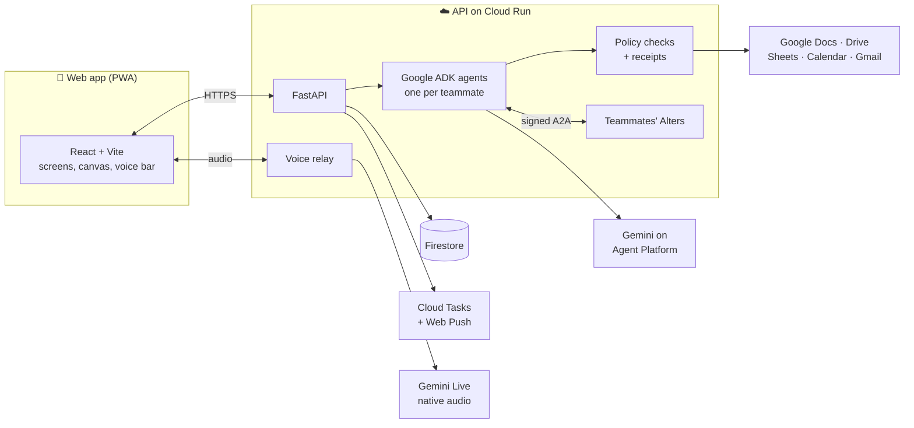

<a name="top"></a>

<p align="center">
  
</p>

<h1 align="center">Alter</h1>

<p align="center"><b>Your AI representative at work: it answers for you within your rules, and does the work in Google Workspace while you're away.</b></p>

<p align="center">
  <a href="https://myalter.web.app/"></a>
  <a href="LICENSE"></a>
  <br>
  <a href="https://www.python.org/"></a>
  <a href="https://fastapi.tiangolo.com/"></a>
  <a href="https://google.github.io/adk-docs/"></a>
  <a href="https://ai.google.dev/"></a>
  <a href="https://a2a-protocol.org/"></a>
  <a href="https://react.dev/"></a>
  <a href="https://vite.dev/"></a>
  <a href="https://firebase.google.com/"></a>
  <a href="https://cloud.google.com/run"></a>
</p>

Everyone on a team gets their own Alter: an AI representative that answers teammates and their
Alters within the limits you set, and works in Google Docs, Drive, Sheets and Calendar for you.
Anything that leaves the team, like sending an email, waits until you say so.

> [!NOTE]
> Alter is live at [myalter.web.app](https://myalter.web.app/). It runs on Gemini 3.7 Flash and
> Gemini 3.5 Flash-Lite, with Gemini Live 2.5 Flash native audio for voice.

## Table of Contents

- [About](#-about)
- [Quickstart](#-quickstart)
- [What's New](#-whats-new)
- [How It Works](#%EF%B8%8F-how-it-works)
- [How to Install](#-how-to-install)
- [How to Use](#-how-to-use)
- [How to Test](#-how-to-test)
- [Project Layout](#%EF%B8%8F-project-layout)
- [Documentation](#-documentation)
- [Roadmap](#%EF%B8%8F-roadmap)
- [Feedback and Contributions](#-feedback-and-contributions)
- [Team and Acknowledgments](#-team-and-acknowledgments)
- [License](#-license)

## 🚀 About

Teams lose time waiting for each other: someone is in meetings, on leave, or in another time
zone. Alter gives each person an AI representative that can answer for them, but only within the
rules they set.

- **Ask a teammate's Alter.** "Why did we switch to one-tap sign-in?" gets an answer with sources
  from Siddhi's notes, even while Siddhi is on leave.
- **Delegate work.** Ask your Alter to update the status doc, add a tracker row or book a meeting,
  and it does it, leaving a before/after record you can inspect. Emails to the team are drafted
  and wait for you: press **Approve** or say "send it".
- **Stay in control.** Each person sets what their Alter may share, and with whom. Requests it
  can't answer, such as committing to a date for someone else, become questions for that person.
- **Alters talk to each other.** One Alter asks another over the
  [A2A protocol](https://a2a-protocol.org/) before interrupting a human. Every request is signed,
  checked against the owner's rules, and recorded with a receipt.
- **Voice first.** Your Alter greets you with a spoken briefing of your day. Talk to it, revise a
  proposal or dictate a reply with [Gemini Live](https://ai.google.dev/gemini-api/docs/live),
  relayed through the API, so no Gemini API key is needed. Every Alter speaks in its own voice.
- **Design by voice.** A saved design canvas (a login-flow diagram) that you edit by voice or text,
  with numbered revisions and undo. After you review it, it's published as a Google Docs
  specification.
- **Meetings.** A meeting companion asks a teammate's Alter questions during a call and records the
  conversation, with everyone's consent. When the meeting ends, your Alter drafts the follow-up:
  status doc changes, a team summary and task board items, ready for you to review together.
- **Your computer, too.** With the small [desktop helper](apps/desktop-helper/README.md), say
  "on my computer, …" and your Alter sees the screen, clicks and types in any app, and asks before
  any step that changes something outside.

Every new visitor gets a private workspace: a copy of a seeded team (Dev, Siddhi, Kani and
Sahil, working on a "Login revamp" project), with its own Drive folder, spreadsheet and calendar.
Select **Step into Dev's day** to start the guided workday as Dev, or type a name to join as a
new member. An invite link lets others join the same workspace.

## ⚡ Quickstart

The fastest way to see Alter is the hosted build at **[myalter.web.app](https://myalter.web.app/)**:
select **Step into Dev's day** and allow microphone access.

To run it on your machine with nothing but Node.js, start the web app in demo mode:

```bash
git clone https://github.com/hack-stuff/alter.git
cd alter/apps/web
npm ci
VITE_MOCK=1 npm run dev
```

Open [http://localhost:5173](http://localhost:5173), type a name and select **Get my Alter**. Demo
mode uses built-in sample data and never contacts a server or writes to Google. For the guided
workday, the design canvas and meetings, run the [local backend](#2-local-backend).

## ✨ What's New

### Latest release

🎙️ **Meetings and review**
- **Faithful meeting answers.** Siddhi's Alter repeats the checked answer with names and who was
  asked, in the third person, and no longer ends on a question. Its meeting tile carries the
  **AI** badge.
- **Edit a review by voice.** Anything you say or type to the voice bar while a meeting review is
  open revises that review. Only a sentence that starts with an instruction counts as an edit, so
  questions still go to chat.
- **Faster, more precise edits.** Review cards are revised in parallel, cutting a spoken edit from
  about 27 s to 16 s. A "Friday" edit moves only the task it names, and the team summary shows the
  new due date.
- **A cleaner review queue.** Approvals shows only what is still pending.

🔊 **Voice**
- **Every Alter has its own voice**, so you can tell who is speaking in a meeting.
- **Steadier sessions.** Voice reconnects after a brief Gemini Live stream failure, repeated tool
  calls no longer use up the workspace limits, and text typed while voice is connecting is kept.
- **Stop and Resume.** The voice bar's **End voice** is now **Stop**, and offers **Resume voice**
  afterwards.

🛠️ **Operations**
- **`DEMO_UNLIMITED=1`** lifts every usage limit for a live demo. Remove it afterwards.

> The meeting AI badge, the faster review edits and the pending-only queue are on `main` but not
> yet deployed to [myalter.web.app](https://myalter.web.app/).

### Earlier

- **The "Quiet Desk" redesign:** an icon rail on laptops and a bottom bar on phones, a docked
  voice bar, humans as circles and Alters as squircles, Google app icons on files and sources,
  light and dark themes.
- **Your Alter does the work:** doc, sheet and calendar changes are applied straight away and kept
  as a record. Emails wait as drafts until you approve them, or just say "send it".
- **Instant navigation:** "Open approvals" or "show the retry node on the canvas" switches screens
  as soon as the words are recognised and highlights the item, without dropping the voice session.
- **The guided workday:** step into Dev's day, hear a briefing, edit the login-flow design by
  voice, join a team meeting with Siddhi's Alter and send the follow-up
  ([how it works](docs/connected-workday.md)).
- **Computer use:** the [desktop helper](apps/desktop-helper/README.md), with a floating window
  that shows progress above every app and offers Allow, Skip, Stop and voice controls.

## 🏗️ How It Works



- **Backend:** Python 3.12, FastAPI and [Google ADK](https://google.github.io/adk-docs/) agents with
  Gemini on Gemini Enterprise Agent Platform (formerly Vertex AI), deployed to Cloud Run.
- **Frontend:** React, TypeScript and Vite as an installable web app (PWA) on Firebase Hosting.
- **State and sign-in:** Firestore, and Firebase anonymous sign-in. All writes go through the API.
- **Voice:** the API relays native audio to Gemini Live with its own Google Cloud credentials.

The design decisions are in [docs/ARCHITECTURE.md](docs/ARCHITECTURE.md), and the endpoints and
data layout in [docs/api-contract.md](docs/api-contract.md).

## 📦 How to Install

There are three ways to run Alter. Start with the first; it needs nothing but Node.js.

| Mode | What you get | Needs |
|---|---|---|
| [1. Demo mode](#1-demo-mode-frontend-only) | The full app with sample answers. Changes reset on reload. | Node.js |
| [2. Local backend](#2-local-backend) | The real API with saved workspaces, invites and simulated AI and Google files. | Node.js, Python 3.12 |
| [3. Cloud](#3-cloud-deployment) | Real Gemini, real Google files, voice, public hosting. | A configured Google Cloud / Firebase project |

**Requirements:** [Node.js](https://nodejs.org/) 20.19+ or 22.12+ (tested with 24) and npm,
[Python](https://www.python.org/) 3.12 for the backend, and Git.

### 1. Demo mode (frontend only)

```bash
cd apps/web
npm ci
VITE_MOCK=1 npm run dev
```

Open [http://localhost:5173](http://localhost:5173), type a name and select **Get my Alter**. The
guided workday, the design canvas and meeting recording need a backend, so they're available only
in modes 2 and 3.

### 2. Local backend

This runs the real API on your machine. It stores workspaces in a local SQLite file, uses a
built-in stand-in for the AI, and simulates Google files. No API keys or accounts are needed.

From the repository root, set up the API once:

```bash
python3.12 -m venv services/api/.venv
services/api/.venv/bin/pip install -c services/api/requirements.lock -e 'services/api[dev]'
npm ci --prefix apps/web
```

Then start the API and the web app in two terminals:

```bash
# Terminal 1: API on port 8080
DEV_MODE=1 SERVICE_URL=http://127.0.0.1:8080 CORS_ORIGINS=http://127.0.0.1:5173 \
  services/api/.venv/bin/uvicorn app.main:app --app-dir services/api --host 127.0.0.1 --port 8080
```

```bash
# Terminal 2: web app on port 5173
VITE_MOCK=0 VITE_DEV_AUTH=1 VITE_API_BASE=http://127.0.0.1:8080/v1 \
  npm --prefix apps/web run dev -- --host 127.0.0.1 --port 5173
```

Open [http://127.0.0.1:5173](http://127.0.0.1:5173) and select **Step into Dev's day**. Workspaces
are saved in `/tmp/alter.sqlite3` (change it with `DATABASE_PATH`). Each browser profile acts as a
separate person, so use a second profile or a private window to try an invite link or a fresh
workday.

All settings are listed, with comments, in [.env.example](.env.example). You can keep API
settings in an ignored root `.env.local` and pass `--env-file .env.local` to uvicorn.

To use real Gemini models, Google files and voice from your machine (with Google Cloud application
default credentials), see the "Run on the Mac" section of
[docs/connected-workday.md](docs/connected-workday.md). That mode sets `AI_BACKEND=vertex`,
`GOOGLE_BACKEND=google`, `LIVE_MODEL` and `LIVE_LOCATION`. With `DEV_MODE=1`, secrets can be read
from local files in `~/.config/alter/secrets/` instead of Secret Manager.

### 3. Cloud deployment

The current build is deployed at [myalter.web.app](https://myalter.web.app/) (Google Cloud
project `x-pathway-511910-q0`, Hosting site `myalter`). A separate deployment needs a
billing-enabled Google Cloud project with Firebase, Firestore and Gemini Enterprise Agent
Platform, and a demo Google account for Docs, Drive, Sheets, Calendar and Gmail. Leave
`VITE_LIVE_TOKEN_BASE` empty to use the API's voice relay; the separate `services/live-token`
service is an older alternative.

| Guide | Covers |
|---|---|
| [Setup and deployment](docs/deployment.md) | The API, Firestore, the Google account and web settings |
| [Connected workday](docs/connected-workday.md) | The current deploy commands, voice model and Meet link settings, and an end-to-end acceptance checklist |
| [Storyboard implementation](docs/storyboard-implementation.md) | Meeting workflows (Cloud Tasks queue), phone notifications (Web Push key), optional Vertex AI Search, and the Meet recording rig |
| [Real-model testing](docs/real-model-testing.md) | Checking real Gemini calls before deploying |

`infra/deploy-api.sh` also sets up the Cloud Tasks queue and messaging permissions. Deploy the
Firestore rules and indexes together with Hosting
(`npx firebase-tools deploy --only firestore,hosting`).

> [!WARNING]
> Before going public, set Agent Platform quotas and a billing budget in the Google Cloud console.
> The app's own limits (120 model calls per member and 400 per workspace each hour) count calls,
> not cost. `DEMO_UNLIMITED=1` turns them all off, so use it only during a supervised demo.

## 🧭 How to Use

After joining, you're one member of the seeded team. If you chose **Step into Dev's day**, your
Alter greets you by voice with your calendar and any pending work (allow microphone access, or
select **Enable voice** if the browser blocks sound). The Alter screen offers four starting points:
join the team sync, shape the login plan on the canvas, see what needs you, and ask about the
launch. You can also type or say these:

| Try | What happens |
|---|---|
| "Why did we switch to one-tap sign-in?" | Your Alter answers with links to its sources. |
| "Ask Siddhi's Alter to confirm the launch date" | Siddhi is on leave and committing to a date is Siddhi's call, so Siddhi's Alter asks Siddhi instead of answering. |
| "Add a QA update to the status doc" | The status doc is updated right away; the change and its before/after record appear in the conversation. |
| "Book 30 min with Kani on Thursday" | The event is added to the team calendar. It's refused if either of you is already busy then. |
| "Email the team a QA summary" | An email draft to teammates' inboxes. Say "send it" or press **Approve** to send. External addresses are blocked. |
| "Open approvals" / "show the retry node" | The screen switches immediately and the item is highlighted. |

On the design canvas, try "Add a retry state if sign-in fails and connect it back to one-tap",
then **Undo last edit** or **Review publication**.

<details>
<summary><b>Every screen</b> (the rail on laptops; the bottom bar and its <b>More</b> sheet on phones)</summary>

- **Home:** your Alter, today's agenda, what's waiting on you, and the ask bar
- **Canvas:** the login-flow design canvas
- **Meeting:** the meeting companion. It asks Siddhi's Alter questions, records the
  conversation, opens a saved Google Meet link and connects a recording rig. Its **Meetings** tab
  lists recorded meetings and their prepared follow-up
- **Approvals:** drafts waiting for you (emails) and a record of changes your Alter made
- **Decisions:** questions other people's Alters need you to answer
- **Team:** teammates and their Alters, the invite link, and asking someone's Alter directly
- **Work log:** what happened while you were away, each with a receipt of the sources and rules used
- **Rules & memory:** what your Alter knows, what it may share, your email and phone notifications
- **Files:** the workspace's Google files and your team inbox
- **Computer:** connect the desktop helper and watch the steps it takes

You can also ask your Alter to open any of them.

</details>

> [!NOTE]
> Opening a link in Google Meet does not put an AI into the call. Joining Meet as "Siddhi's Alter"
> needs the OBS and audio-routing setup in
> [docs/storyboard-implementation.md](docs/storyboard-implementation.md#prepare-and-record-the-meet-scene).

## 🧪 How to Test

| Part | Command (from the repository root) |
|---|---|
| API (Python) | `PYTHONPATH=services/api services/api/.venv/bin/pytest services/api/tests -q` |
| Web: type check and build | `npm --prefix apps/web run build` |
| Web: lint | `npm --prefix apps/web run lint` |
| Web: browser tests (demo mode) | `npm --prefix apps/web run test:e2e` |
| Web: browser tests against the local API | `npm --prefix apps/web run test:backend` |
| Web: installable app (PWA) | `npm --prefix apps/web run test:pwa` |
| Voice token service | `cd services/live-token && .venv/bin/python -m pytest -q` (set up its `.venv` as in [its README](services/live-token/README.md)) |
| Firestore security rules | `npm ci --prefix infra && npm --prefix infra run test:rules` (needs Java for the Firebase emulator) |

The browser tests need Playwright's Chromium: run `cd apps/web && npx playwright install chromium`
once. The tests use stand-ins for Gemini, Firebase and Google, so they don't prove that the real
services work; [docs/real-model-testing.md](docs/real-model-testing.md) covers that. To check real
voice, `services/api/scripts/test_live_audio.py` sends a synthetic greeting to the configured
native-audio model (a paid call; see [docs/connected-workday.md](docs/connected-workday.md)).

## 🗂️ Project Layout

```
apps/web/              React + Vite web app (PWA): Alter screen, design canvas, meeting
                       companion, recording kiosk, other screens, voice, demo mode
apps/desktop-helper/   The desktop helper that lets your Alter use your computer
services/api/          FastAPI + Google ADK backend: workspaces, Alters, A2A, approvals,
                       policy checks, Google app actions, meetings, plans, the voice relay
                       and notifications
services/api/scripts/  Helper scripts: demo tokens, voice and model smoke tests, Search setup
                       and the world seeder
services/live-token/   Older alternative voice transport: single-use Gemini Live tokens
contracts/             Shared sample data used by both the app and the API
infra/                 Deployment script, Cloud Build config, Firestore rules tests
docs/                  Architecture, API contract, setup and deployment
firestore.rules        Who may read what in Firestore (all writes go through the API)
```

The demo video, submission deck and storyboard live outside this repository, so it holds only
what runs the app.

## 📚 Documentation

| Doc | What it covers |
|---|---|
| [docs/connected-workday.md](docs/connected-workday.md) | **Start here:** the current workday experience, local setup and acceptance checks |
| [docs/deployment.md](docs/deployment.md) | Cloud prerequisites, deploying the API and Hosting, operating limits |
| [docs/storyboard-implementation.md](docs/storyboard-implementation.md) | Meeting workflows, voice relay, phone notifications, Search and the Meet rig |
| [docs/real-model-testing.md](docs/real-model-testing.md) | Checking real Gemini calls before deploying |
| [docs/ARCHITECTURE.md](docs/ARCHITECTURE.md) | Positioning and design decisions |
| [docs/api-contract.md](docs/api-contract.md) | API endpoints, Firestore layout, seed data, limits |
| [apps/desktop-helper/README.md](apps/desktop-helper/README.md) | Running and connecting the desktop helper |

## 🗺️ Roadmap

- [x] Set up the Google Cloud and Firebase project, Agent Platform models and the demo Google account
- [x] Run the real-model and native-audio tests against Agent Platform
- [x] Deploy the API to Cloud Run and the app to Firebase Hosting
- [x] Deploy the workday, meeting and notification changes (Cloud Tasks queue, Firestore indexes)
- [x] Redesign the web app (Quiet Desk design)
- [x] Deploy the autonomous-Alter behavior, voice navigation and per-Alter voices
- [ ] Deploy the latest meeting and review fixes (AI badge, faster review edits, pending-only queue)
- [ ] Run the Firestore security rules tests with the Firebase emulator
- [ ] Set Agent Platform quotas and a billing budget with alerts
- [ ] Check phone notifications, Search indexing and real Google writes after redeploying
- [ ] Rehearse the Google Meet recording rig end to end
- [ ] Finish and upload the demo video

## 🤝 Feedback and Contributions

Alter is built by Team Cold Silicon, and we aren't accepting outside contributions right now.

> [!IMPORTANT]
> Found a bug? Open an issue at [hack-stuff/alter/issues](https://github.com/hack-stuff/alter/issues)
> with what you ran, what you expected and what happened. If an error message includes a
> `Reference:` code, include it: it matches the server log entry.

For team members:

1. Create a branch from `main`.
2. Make your change in the style of the surrounding code.
3. Run the tests above for the parts you touched (at minimum the API tests, the web build, lint
   and `test:e2e`).
4. Open a pull request with a short description of what changed and how you tested it.

Keep secrets out of the repository. Configuration takes Secret Manager resource names, never
secret values (see [.env.example](.env.example)).

## 👥 Team and Acknowledgments

**Team Cold Silicon:** Devesh, Sahil, Priyanshu and Kanmani.

Built with [Google ADK](https://google.github.io/adk-docs/), the
[A2A protocol](https://a2a-protocol.org/), [Gemini](https://ai.google.dev/) on Gemini Enterprise
Agent Platform, [Firebase](https://firebase.google.com/), [FastAPI](https://fastapi.tiangolo.com/),
[React](https://react.dev/) and [Vite](https://vite.dev/).

## 📃 License

Alter is released under the [MIT License](LICENSE). You may use, copy, modify and distribute it
freely, provided the copyright notice and license text stay with it.

[Back to top](#top)
